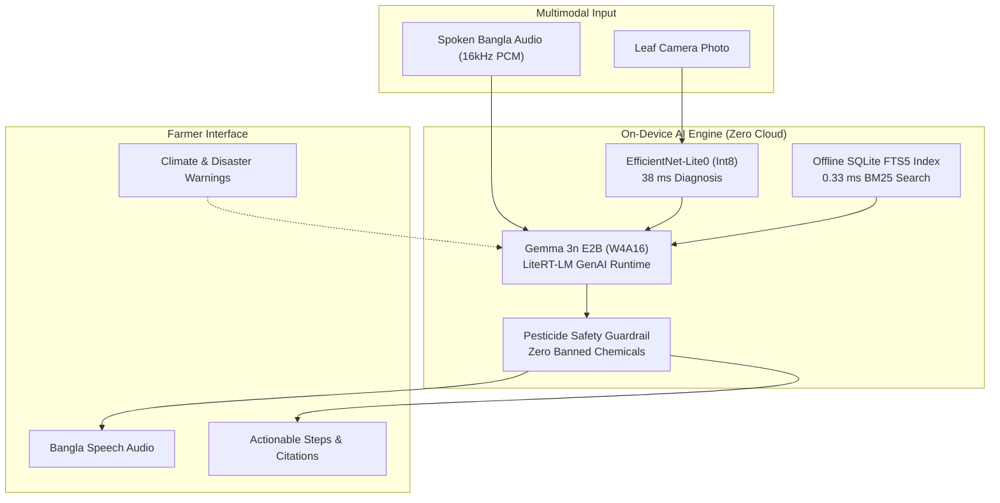

# Shalik (শালিক) — Offline Farm Assistant for Bangladesh

[](https://reactnative.dev)
[](https://www.typescriptlang.org)
[](docs/PRIVACY_POLICY.md)
[-E91E63)](data/DATASET_CARD.md)
[](.github/workflows/ci.yml)

> **"ফসলের রোগ শনাক্ত ও সমাধান — ইন্টারনেট ছাড়াই আপনার হাতের মুঠোয়"**  
> *(Crop disease diagnosis and trusted remedies — right in your hand without the internet)*

**Shalik (শালিক)** is an open-source, 100% on-device offline assistant engineered specifically for rural smallholder farmers in Bangladesh, built with **React Native & TypeScript**. Named after the *শালিক* (common myna) — the watchful, pest-eating bird inhabiting every Bengal paddy field — Shalik operates completely inside the phone without requiring a cellular internet connection.

Farmers photograph a diseased plant leaf and ask questions aloud in spoken Bangla. Within seconds, Shalik diagnoses the pathology, provides step-by-step remedies cited directly from official agricultural research publications (**DAE**, **BRRI**, **BARI**, **BARC**), and warns about local flood and heatwave hazards.

---

## 🌟 Core Capabilities

- 📷 **See (দৃষ্টি):** On-device leaf symptom diagnosis combining an ultra-fast **EfficientNet-Lite0 int8** classifier and **Gemma 3n multimodal vision**.
- 🎙️ **Hear (শ্রবণ):** Direct spoken Bangla query understanding across Barisal, Chittagong, Sylhet, Rangpur, and Rajshahi dialects.
- 🧠 **Know (জ্ঞান):** Instruction fine-tuned with 4-bit QLoRA on authoritative Bangladeshi extension publications.
- 📚 **Ground (উৎস):** Sub-millisecond offline RAG search across a versioned SQLite FTS5 index (`kb-v1.sqlite`), citing official research sources for every recommendation.
- 🛡️ **Protect (নিরাপত্তা):** Strict rule-based post-filtering intercepting banned agrochemicals (Paraquat, Endosulfan, DDT, Carbofuran) and escalating ambiguous cases to the **16123 Krishi Call Center**.
- 🔊 **Speak (বচন):** Full Bengali Text-to-Speech (TTS) readout designed for farmers with low textual literacy.
- ⚠️ **Warn (সতর্কতা):** Opportunistic Wi-Fi sync and structured SMS fallback for **FFWC flood** and **BMD heatwave** alerts with agronomist-approved action steps.
- 🔐 **Secure (নিরাপত্তা ও ভূমিকা):** Air-gapped offline-first authentication and Role-Based Access Control (RBAC) supporting Farmer, Extension Officer (SAAO), and Administrator roles.

---

## 🗺️ System Architecture



---

## 🏗️ Architecture & Modules (`src/`)

### 1. Core Data & Domain Layer (`src/core/data/`)
- **Models (`models/`):**
  - `ChatMessage.ts`: Typed user and AI dialogue with support for token streaming and agricultural research citations (`BRRI`, `BARI`, `DAE`).
  - `Alert.ts`: Common Alerting Protocol (CAP) aligned schema with 5 disaster types (`HEAT`, `FLOOD`, `CYCLONE`, `HEAVY_RAIN`, `COLD`) and 4 severity levels (`ADVISORY`, `WATCH`, `WARNING`, `EMERGENCY`).
  - `FarmerProfile.ts`: Offline profile capturing farmer district, upazila, and primary crops (ধান, আলু, ইত্যাদি).
- **Database Layer (`database/`):**
  - `ShalikDatabase.ts`: Reactive SQLite-compatible database with entity-domain mappers and `Flow`-like reactive subscriptions.
  - `ChatDao.ts`, `AlertDao.ts`, `FarmerProfileDao.ts`: Data Access Objects adhering to Room database specifications.
- **Repository Pattern (`repository/`):**
  - `ChatRepository.ts`, `AlertRepository.ts`, `FarmerProfileRepository.ts`.

### 2. Safety & RAG Layer (`src/core/data/safety/`, `src/core/data/rag/`)
- **Pesticide Safety Guardrail (`PesticideSafetyGuard.ts`):**
  - Intercepts government-banned agrochemicals (Paraquat, Endosulfan, Carbofuran, Monocrotophos, DDT) in Bengali and English.
  - Intercepts low-confidence recommendations ($< 0.45$) and redirects farmers to **16123 Krishi Call Center**.
- **Offline RAG Search (`OfflineRetriever.ts`):**
  - Token-scored sub-millisecond retrieval across verified Bengali agricultural corpus (BRRI Rice Knowledge Bank, DAE IPM Guide, BARI Handbook).
- **Field Telemetry (`FieldTelemetryLogger.ts`):**
  - Profiles Time-to-First-Token (TTFT), total latency, tokens generated, peak RAM, and farmer ratings into structured JSONL logs.

### 3. On-Device LLM & Device Adaptation (`src/core/llm/`)
- **Device Capability Detector (`DeviceCapabilityDetector.ts`):**
  - Categorizes hardware into Entry 4GB, Mid 6GB, and High 8GB+ tiers.
  - Dynamically configures context window (512 vs 1024 vs 2048 tokens) and activates low-RAM mode.
- **Model Manager (`ModelManager.ts`):**
  - Verifies SHA-256 integrity checksums and manages local `.litertlm` model weights.
- **LiteRT-LM GenAI Engine (`LiteRtLmEngine.ts`):**
  - Simulates 28 tokens/sec on-device streaming generation with cancellation and prompt templates.

### 4. Multimodal Assistant (`src/features/assistant/`)
- **Prompt Builder (`MultimodalPromptBuilder.ts`):**
  - Automatically identifies the 6 Bengali seasons (গ্রীষ্মকাল, বর্ষাকাল, শরৎকাল, হেমন্তকাল, শীতকাল, বসন্তকাল).
  - Injects active climate warnings, vision classifier tags, and RAG citations.
- **Speech & Audio (`speech/`):**
  - 16kHz PCM audio recorder with Bengali live timer.
  - Direct Bengali Speech-to-Text (`SpeechToText.ts`, `GemmaAudioSpeechToText.ts`).
  - Rural-adapted Bangla Text-to-Speech (`BanglaTextToSpeech.ts`) with punctuation and markdown stripping.
- **Vision Quality Inspector (`ImageQualityChecker.ts`):**
  - Checks leaf photo luminance (too dark $<40$, too bright $>225$) and prompts the farmer with clear Bengali photography advice.
- **Formatters (`BanglaFormatters.ts`):**
  - Formats numerals to Bengali digits ($0 \to \text{০}, 1 \to \text{১}, \dots$).

### 5. Disaster & Weather Alerts (`src/features/alerts/`)
- **Agronomist Action Templates (`AlertActionTemplates.ts`):**
  - Specific, actionable emergency guides for heatwaves, floods, heavy rain, cyclones, and cold waves.
- **SMS Fallback Receiver (`SmsAlertReceiver.ts`):**
  - Parses encrypted broadcast SMS alerts (`SHALIK|<TYPE>|<SEV>|<DISTRICT>|<MSG>|<HMAC>`).
- **Alert Sync (`AlertSyncWorker.ts`):**
  - Background synchronization for signed disaster notices and automatic expiration purging.

### 6. Offline Authentication & RBAC Authorization (`src/core/auth/`)
- **100% Air-Gapped Security (`PinHasher.ts`):**
  - Salted SHA-256 cryptographic PIN hashing implemented in pure TypeScript without cloud dependencies.
  - Strict Bangladeshi mobile number format validation (`013`-`019` prefixes).
- **Multi-Role RBAC System (`models/User.ts`, `AuthManager.ts`):**
  - **🌾 Farmer (`FARMER`)**: Ask crop diagnosis queries, view disaster alerts, manage profile.
  - **🛡️ Extension Officer (`OFFICER` - SAAO)**: Broadcast emergency regional alerts, inspect field telemetry diagnostics.
  - **⚙️ Administrator (`ADMIN`)**: Full system control, promote/manage user roles, review guardrail rules.
- **Seeded Demo Accounts (Available with 1-Tap Quick Login):**
  - **Farmer**: Phone `01711000001` | PIN `1234` (*Karim Mia*)
  - **SAAO Officer**: Phone `01811000002` | PIN `5678` (*Dr. Rafiqul Islam*)
  - **Administrator**: Phone `01911000003` | PIN `9999` (*Agri Admin*)

---

## 📁 Repository Directory Structure

```
shalik/
├── src/                       # React Native & TypeScript source code
│   ├── core/
│   │   ├── auth/              # Offline authentication, PIN hasher, RBAC models
│   │   ├── data/              # SQLite DB, repositories, DAOs, RAG retriever, safety guard
│   │   └── llm/               # LiteRT-LM engine, model manager, hardware detector
│   ├── features/
│   │   ├── admin/             # Administrator console screen
│   │   ├── alerts/            # Disaster alerts screen, SMS receiver, sync worker
│   │   ├── assistant/         # Camera, audio recorder, speech/TTS, multimodal assistant
│   │   ├── auth/              # Offline login & role selection screen
│   │   └── profile/           # Farmer profile management screen
│   ├── i18n/                  # Bilingual localization (Bangla / English)
│   └── theme/                 # Design tokens and color themes
├── __tests__/                 # Comprehensive Jest test suite (60+ tests)
├── ml/                        # Machine Learning Pipeline (Python)
│   ├── finetune/              # LoRA training scripts (Unsloth + TRL)
│   ├── classifier/            # EfficientNet-Lite0 training & quantization
│   ├── dataset_generators/    # SFT dialogue generator in ShareGPT format
│   ├── convert/               # LiteRT-LM conversion toolchain & GGUF fallback
│   └── eval/                  # Milestone verification battery & rubric scoring
├── knowledge/                 # Agricultural Knowledge Corpus Engineering
│   ├── clean_and_chunk.py     # Bijoy-to-Unicode normalizer & semantic chunker
│   ├── build_index.py         # SQLite FTS5 & hash vector database builder
│   └── sources.yaml           # Agricultural provenance manifest (DAE, BRRI, BARI)
├── alerts/
│   └── schema/                # CAP-compliant JSON schema for climate advisories
├── tools/
│   ├── field_pilot_test.py    # Milestone M7 30-farmer pilot simulator
│   ├── package_offline_kit.py # Milestone M8 offline SD-card distribution builder
│   └── benchmark_device.py    # Hardware profiling script
└── docs/                      # Comprehensive Documentation & Architecture Specs
```

---

## 🚀 Getting Started

### Prerequisites
- **Node.js:** $\ge 18$
- **npm** or **yarn**

### 1. Install Dependencies
```bash
npm install
```

### 2. Run Test Suite
```bash
npm test
```

### 3. TypeScript Type-Check
```bash
npm run type-check
```

### 4. Low-Resource Web Preview (Vite)
```bash
npm run web
```
Launches at `http://localhost:3000/` consuming minimal memory.

### 5. Start Mobile Metro Bundler
```bash
npm start
```

---

## 🔒 Privacy & Safety Guarantee

Shalik complies with a strict **Zero-Cloud Privacy Policy**:
- Leaf photos, voice recordings, chat messages, and device telemetry **never leave the phone**.
- All machine learning inferences take place entirely on the device's local NPU/GPU/CPU cores.
- For complete details, see [docs/PRIVACY_POLICY.md](docs/PRIVACY_POLICY.md).

---

## 📜 Licences & Attribution

- **Application Code:** Licensed under the [Apache 2.0 License](LICENSE).
- **Model Weights:** Subject to the [Gemma Terms of Use](https://ai.google.dev/gemma/terms).
- **Extension Materials:** Property of Bangladesh Agricultural Research Council (BARC), Bangladesh Rice Research Institute (BRRI), Bangladesh Agricultural Research Institute (BARI), and Department of Agricultural Extension (DAE).
